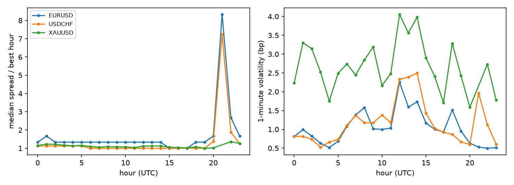

# FX and Gold Execution Analytics on Tick Data: Spreads, News, Latency and Order Slicing

What does it cost to execute a client order in EUR/USD, USD/CHF and gold, and when? This project measures it from
one month of real top-of-book quotes: how the spread and volatility move through the 24-hour day, what happens around
payrolls, CPI, the FOMC and the SNB, how much the price moves while a quote is in flight, and whether slicing an order
over time pays.

**Data.** Dukascopy public tick feed (best bid and ask with displayed size, timestamped to the millisecond),
September 2025: 1.29 M EUR/USD, 0.76 M USD/CHF and 4.35 M XAU/USD quotes. The feed throttled the download, so the
month is incomplete: **84 %** of trading hours for EUR/USD, **70 %** for USD/CHF and **71 %** for gold. Every event
hour is present except USD/CHF at the FOMC. Prices check: EUR/USD 1.169 to 1.173, gold 3,444 to 3,863 USD/oz over
the month. Quotes arrive at least 50 ms apart, which sets the shortest latency the data can resolve.

## In short

| Question | Answer |
|---|---|
| Normal spread | Median **0.4 pip** EUR/USD (0.3 in the London/New York overlap, 15-17 UTC), **0.8 pip** USD/CHF, **0.58 USD/oz** gold. |
| When is liquidity worst? | The 21:00 UTC rollover: EUR/USD 2.5 pips (8x the best hour), USD/CHF 5.8 pips (7x); gold widens to 0.71 USD at 22:00. Volatility peaks at 12-14 UTC, the US data window. |
| News | US payrolls: EUR/USD moved **34 pips** in 5 minutes (same slot on other Fridays: median 4.5), and the spread reached **9.5 pips** (24x normal); gold moved 22 USD (normal 3.5) with spreads up to 6 USD. FOMC: EUR/USD 39 pips against a normal 1. SNB (hold): USD/CHF 11 pips against 0.7; EUR/USD did not react. |
| What does latency cost? | Mean absolute mid move after a quote: EUR/USD **0.075 pip at 250 ms, 0.15 pip at 1 s** (67 % of quotes have moved by then); gold 0.41 and 0.97 pip (0.1 USD); USD/CHF 0.05 and 0.10 pip. Relative to the half-spread a client pays, one second of delay is worth **84 %** in EUR/USD, 35 % in gold and 24 % in USD/CHF: the tightest market is the most latency-sensitive. |
| Immediate vs sliced execution | 2,000 random arrivals per pair (weekdays 06-20 UTC), buys and sells: crossing at once costs the half-spread (0.175 pip EUR/USD, 0.40 USD/CHF, 2.8 pips gold). Slicing into 30-second clips over 30 minutes leaves the drift-neutral mean cost **unchanged** (0.176, 0.401, 2.78) while the spread of outcomes grows from 0.09 to **4.8 pips** (EUR/USD) and from 0.8 to 30 pips (gold). With top-of-book clips and no market impact, slicing buys only timing risk; it pays when the order is large enough to move the price. |
| Does the month's trend matter? | Yes, one-sidedly: gold rose 12 % in September, so sliced buys cost 4.9 pips and sliced sells 0.6. Averaging buys and sells removes that drift, which is why both are reported. |

## Method (`src/fxexec/analytics.py`)

* **Decoding:** each hourly `.bi5` file is LZMA-compressed 20-byte big-endian records (ms after the hour, ask, bid,
  ask and bid size); prices are scaled by 1e-5 (FX) or 1e-3 (gold). Pip = 0.0001 (FX) and 0.1 USD (gold).
* **Liquidity by hour:** median and 90th-percentile quoted spread, median displayed size, quotes per minute,
  standard deviation of 1-minute log returns.
* **Events:** spread in the 10 minutes before and the first 2 minutes after the release; absolute mid change from
  1 s before to 5 minutes after, against the same weekday and time on the other weeks of the month.
* **Latency:** 20,000 random quotes; the mid change to the last quote within 50 ms to 1 s. This is the move a
  delayed fill or a last-look window exposes; on average half of it is adverse to the side that waits.
* **Execution:** arrival times uniform in clock time, the same arrivals for every horizon, kept only if every child
  order finds a quote at most 60 s old (no data gaps). Implementation shortfall against the arrival mid: buy at the
  ask, sell at the bid; immediate, or equal clips every 30 s over 5, 15 or 30 minutes.

## Verification (`pytest tests`, 4 tests)

| Check | Result |
|---|---|
| bi5 decoding of hand-built, LZMA-compressed records | times, prices and sizes exact |
| Constant spread, flat market: immediate and sliced orders | both cost exactly the half-spread |
| Linear drift of 0.01 pip/s, 5-minute slicing | buy = half-spread + 1.35 pip, sell = half-spread - 1.35 pip, average = half-spread (1e-6) |
| Latency on the same drift | 0.01 pip per second, every quote moved |

## Limitations

* Dukascopy is one liquidity provider's aggregated feed, not the interbank market or Swissquote's own pricing;
  spreads and sizes are indicative of the market, not of any one venue.
* An incomplete month (70-84 % of hours, see above) and one month only; the event study is four releases, so it
  shows magnitudes, not statistics.
* Top-of-book only: no depth, no market impact, so slicing can only add risk here. A real comparison needs an impact
  model (for example square-root impact calibrated to fills) and the client's order size.
* Latency below 50 ms is beyond the feed's resolution.

## Run

    pip install numpy pandas matplotlib pytest
    python scripts/download.py     # about 2,160 hourly files; throttled, slow by design
    python scripts/run_all.py
    pytest tests

Results: `results/summary.json`. Figure: `figures/liquidity_by_hour.png`.
